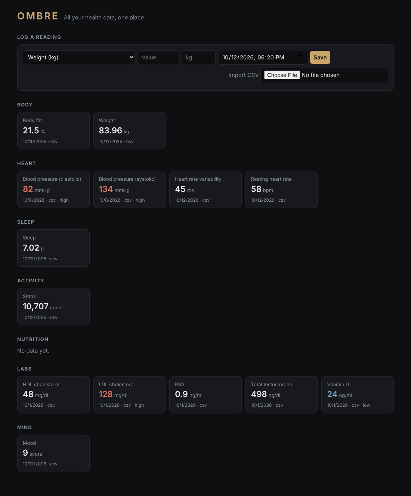

# Ombre

Men's health app that connects all your data — wearables, scale, labs, nutrition, mood — into one place.



## How it works

Every source is converted into one shape, an **observation**: a metric, a value in that metric's standard unit, a time, and where it came from.

```
Apple Health ─┐
CSV / labs ───┼─► normalize() ─► SQLite ─► API ─► dashboard
Manual entry ─┘   (units, validation)   (dedupe, daily roll-ups, range flags)
```

- **`src/core/metrics.ts`** — the catalog of ~30 metrics across body, heart, sleep, activity, nutrition, labs (testosterone, PSA, lipids, HbA1c, vitamin D) and mind. Each has a standard unit, a daily roll-up rule (sum/avg/last), and an optional adult-male reference range for flagging.
- **`src/core/observation.ts`** + **`units.ts`** — validation and unit conversion (lb→kg, mmol/L→mg/dL, etc.).
- **`src/store/db.ts`** — SQLite storage (built into Node). Re-importing the same data doesn't create duplicates.
- **`src/ingest/`** — importers: generic CSV and Apple Health `export.xml` (streamed, so multi-GB exports are fine).
- **`src/server/`** — JSON API plus a single-page dashboard in `public/`.

No runtime dependencies: Node 22.18+ runs the TypeScript directly.

## Run it

```sh
npm install
npm run import -- csv examples/sample.csv   # optional: 90 days of demo data
npm start                                   # http://localhost:3000
```

Import your own data:

```sh
npm run import -- apple ~/Downloads/apple_health_export/export.xml
npm run import -- csv my-labs.csv           # columns: date,metric,value[,unit][,end][,note]
```

Check everything: `npm test` and `npm run typecheck`.

## API

| Method | Path | |
|---|---|---|
| GET | `/api/metrics` | Metric catalog |
| GET | `/api/summary` | Latest value per metric, with high/low flags |
| GET | `/api/observations?metric=&from=&to=&limit=` | Raw readings |
| POST | `/api/observations` | Add one reading or an array (`{metric, value, unit?, start, end?, note?}`) |
| DELETE | `/api/observations/:id` | Remove a reading |
| GET | `/api/daily/:metric?from=&to=` | One value per day |
| POST | `/api/import/csv` | Upload CSV body |

## Next steps

- **More sources:** Oura, Whoop, Garmin, Withings, Fitbit (OAuth + sync jobs), lab PDF upload (Quest/Labcorp).
- **Accounts:** multi-user auth, encryption at rest — this is health data.
- **Insights:** trends, correlations (sleep vs. HRV, alcohol vs. recovery), lab-retest reminders.
- **Mobile:** iOS app with HealthKit sync so there's no manual export.
- Days are currently grouped by UTC date; switch to the user's time zone once accounts exist.

Reference ranges are typical values for adult men and are for information only — not medical advice.
